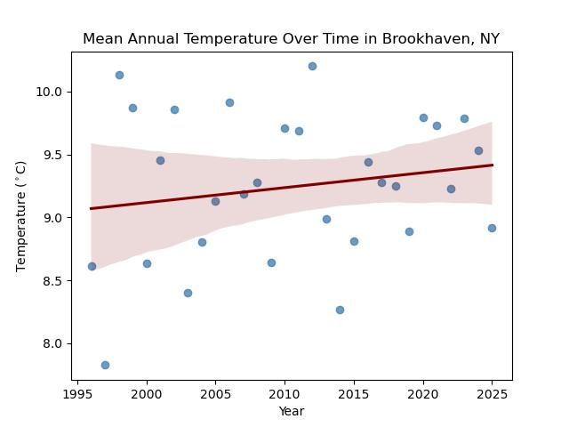

## Claire Wadler - Water Quality Scientist
Portfolio showcasing my environmental data science projects.

#### Contact Information
* clairewadler@gmail.com
* [View my GitHub Profile](https://github.com/clairewadler)
* [View my ORCID](https://orcid.org/0009-0006-9958-7316)

### About Me

I currently work for the Colorado Department of Public Health and Environment in the Water Quality Control Division as a PFAS Program Specialist. When I first moved to Colorado in 2023, I worked as a Research Assistant at the WE2ST Hub in Colorado School of Mines, where I did chemical characterization work on recycled water. Before moving to Colorado, I attended Georgia State University and researched transit time distributions in urban beaver ponds. I have also lived in Oklahoma, where I worked for the EPA's Groundwater Characterization and Remediation Division, and Austin, where I attended the University of Texas. My interest in studying water quality began as a child growing up in Houston, TX, where in the aftermath of floods and hurricanes, we would sometimes go weeks without clean tap water. I continue to seek opportunities that will help me grow as a water quality professional and contribute to creating sustainable outcomes within our watersheds.

#### Professional Background
* 05/2025 - Present &emsp;&nbsp; PFAS Program Specialist, CDPHE
* 06/2023 - 06/2025 &emsp; Research Assistant, Colorado School of Mines
* 12/2022 - 05/2023 &emsp; GIS Intern, City of Sandy Springs

#### Educational Background
* MS Geosciences, Georgia State University, Atlanta, GA, 2023
* BSA Chemistry, University of Texas, Austin, TX, 2017

### Projects
I will be posting my projects and assignments for the Earth Data Analytics Certificate program here. I am excited to learn how to apply programming languages to analyze environmental data, particularly hydrologic data, and explore how to automate my workflows.

*Monarch Butterfly (Danaus plexippus) Annual Migration Pattern, created 10/2026*

Click the photo to explore an interactive map displaying the monarch migration during 2020

<a href = "img/monarch_migration_plot.html" target = "blank">
  
  
 

  <figcaption>Photo of a Monarch Butterfly. Source J. Corey Butler, 2005, Wikimedia Commons</figcaption>
</a>

Monarchs are an iconic butterfly species known for their bright orange wings. Every year, the North American monarch makes it's multigenerational, round trip migration across the continent to their overwintering sites and back. And the monarch isn't just known in North America anymore, over the past 200 years they have also spread to other parts of the world, often forming non-migratory populations. Wherever there is milkweed, the monarch's host plant, a monarch can potentially be found. But land use change and other human practices are destroying milkweed plants, causing a decline in monarch populations. Studying migration patterns and monarch observations can help highlight how monarch populations are being effected and what can be done to help bring their populations back.

Occurrence data was downloaded from the Global Biodiversity Information Facility (GBIF) and spatially joined to the RESOLVE Ecoregions 2017 dataset using Python. Occurrence data was normalized by space (ecoregion) and time (month) to account for sampling bias. Instances where only one occurrence was documented in an ecoregion were not included in the interactive plot to help account for misidentified species.

[The full data analysis can be found here.](portfolio_posts/Monarch_migration_portfolio)

Data Sources

Dinerstein, E., Olson, D. M., Joshi, A., Vynne, C., Burgess, N. D., Wikramanayake, E. D. 2017. "RESOLCE Ecoregions 2017". RESOLVE <https://ecoregions.world/>

GBIF.org (24 October 2026) GBIF Occurrence Download <https://doi.org/10.15468/dl.fp52e5>

*Temperature Data Show Temperatures have Increased Over a 30 Year Period in Brookhaven, NY, created 9/2026*

Long Island has been identified as a region particularly prone to climate change impacts. Brookhaven is a town located in central Long Island, and has warmed an average of 0.01&deg;C per year from 1996 to 2025. This is a slightly [slower rate][1] than has been predicted. To see more details on this project, [you can find the full analysis here.](portfolio_posts/portfolio_export_2)

[1]: https://nysclimateimpacts.org/explore-by-region/the-long-island-region/#section-8

*Interactive Map of Schlitterbahn Waterpark in New Braunfels, created 9/2026*

<embed type="text/html" src="img/Schlitterbahn.html" width="600" height="600">
